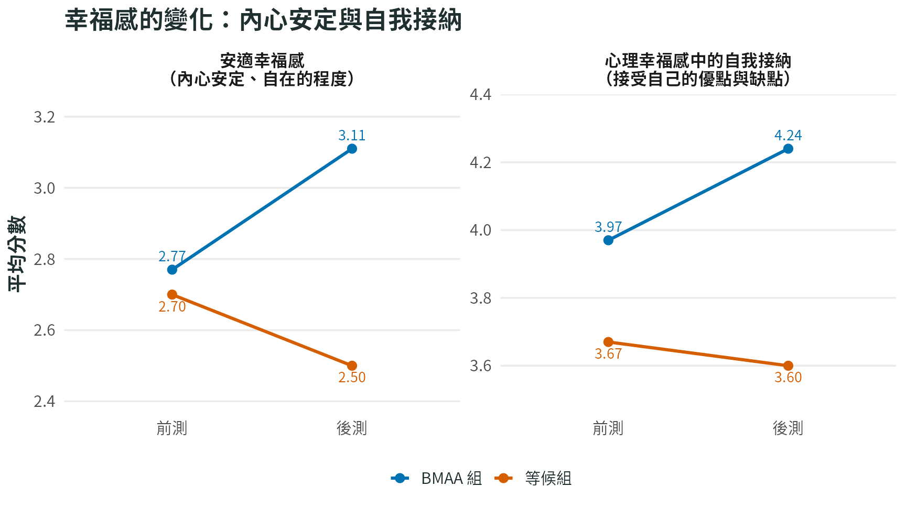

```{r}
#| include: false
source("../R/bmaa_plot_theme.R")
source("../R/2025_li_happiness_agency.R")
```

這項研究發現，BMAA 組的安適幸福感（內心安定、自在的程度）與自我接納有所提升，學期末的情緒也較能維持穩定。自我接納是心理幸福感的一個面向，指能接受自己的優點、缺點與過去經驗。

::: {.study-cover}
<a href="../assets/study-covers/2025-li-happiness-agency.png" aria-label="放大幸福感指標比較圖"></a>

封面圖：左圖是安適幸福感（內心安定、自在的程度），右圖是心理幸福感中的自我接納（接受自己的優點與缺點）。BMAA 組這兩項分數上升，等候組則下降。數值為論文表 5 的前後測平均分數，兩圖縱軸範圍不同。點圖可放大。
:::

## 方法

- 參與者：共 115 人完成前後測，BMAA 組 62 人、等候組 53 人，皆為大學生或研究生，平均年齡約 23 歲。
- 研究設計：比較兩組在課程前後的問卷分數。等候組在研究期間沒有參加 BMAA 或其他研究相關活動。
- 課程安排：研究期間為 12 週。扣除國定假日，共上課 11 次，每次 3 小時，合計 33 小時；另有 6 次團體複習，共 4 小時，並鼓勵每天自行練習。
- 練習內容：動態身體練習、呼吸、按摩放鬆，以及在坐姿、行走和日常活動中留意身體感覺。

研究使用的問卷涵蓋下列面向：

| 測量面向與工具 | 在評估什麼？ |
|---|---|
| 內感覺覺察：多向度內感覺覺察量表第二版（MAIA） | 能否留意、理解並運用身體訊號。八個面向包括注意身體感覺、不忽略不適、不過度擔心不適、理解情緒與身體的關係、調整注意力、安定自己、傾聽身體，以及信任身體。 |
| 身體節律覺察：身體覺察量表（BAQ） | 能否察覺疲累、飢餓、睡眠等身體狀態及其變化規律。 |
| 覺察當下：止觀量表（MAAS） | 能否留意自己此刻正在做的事，較少不知不覺地分心或自動行事。 |
| 能動感：雙向度能動感量表 | 感覺自己能掌握行動與內在狀態的程度。「外在行動」是覺得自己有辦法採取行動、因應事情；「內在調節」是覺得自己能調整情緒，較少被情緒牽著走。 |
| 安適幸福感量表 | 內心是否感到平靜、自在、安定。 |
| 心理幸福感量表 | 對自己與生活發展的評價，包括自我接納、人際關係、自主性、掌握生活環境、人生目標與自我成長。 |
| 生活滿意度量表、正負向情緒量表（PANAS） | 對整體生活是否滿意，以及近期正、負向情緒出現的頻率。研究也將這三項合成「主觀幸福感」指標。 |

這些指標都是參與者對自己的評估；身體覺察問卷分數上升，代表自覺更能覺察身體，並非測量心跳等生理訊號的偵測準確度。

## 主要發現

### 安適幸福感與自我接納提升

將兩組原本的分數差異納入比較後，BMAA 組在安適幸福感與自我接納上的表現較好。

安適幸福感是內心平靜、自在的感受。BMAA 組平均分數從 2.77 升至 3.11，等候組則從 2.70 降至 2.50。自我接納是能接受自己的優點、缺點與過去經驗；BMAA 組從 3.97 升至 4.24，等候組則從 3.67 降至 3.60。

### 學期末的情緒較能維持穩定

BMAA 組的正向情緒大致維持不變，負向情緒略為下降；等候組則出現正向情緒減少、負向情緒增加的情形。把課前分數差異納入比較後，兩項情緒指標都顯示 BMAA 組表現較好。

後測約在期末考前兩週進行。作者推測，BMAA 可能幫助學生在壓力較大的時候維持情緒穩定；考試壓力是否造成這種變化，仍需進一步驗證。

```{r}
#| label: fig-li-emotions
#| fig-height: 4.8
#| fig-alt: "BMAA 組正向情緒從 3.22 至 3.27，負向情緒從 2.73 至 2.58；等候組分別從 2.94 至 2.77、2.67 至 2.80。"
#| fig-cap: "情緒前後測平均分數（論文表 5）。正向情緒越高，代表較常感到有興趣、投入等；負向情緒越高，代表較常感到緊張、內疚等。兩個圖的縱軸範圍不同，請分別閱讀。"
li_study_plot(
  c("正向情緒", "負向情緒"),
  "BMAA 組的情緒較能維持穩定",
  labels = c("正向情緒（越高越常出現）", "負向情緒（越低越少出現）")
)
```

### 更能覺察身心，並掌握自己的狀態

將課前分數差異納入比較後，BMAA 組的內感覺覺察八個面向、身體節律覺察，以及覺察當下的表現，都優於等候組。這些結果表示，參與者自覺更能留意身體變化、運用身體感覺安定自己，也更能把注意力放回正在做的事。

能動感的兩個面向也都有提升：學生更覺得自己有能力採取行動，也更有能力調節內在狀態。下圖呈現其中兩項覺察指標，以及兩種能動感的變化。

```{r}
#| label: fig-li-awareness-agency
#| fig-height: 7.2
#| fig-alt: "BMAA 組用身體感覺安定自己的分數從 2.90 升至 3.74，覺察當下從 3.54 升至 3.96，外在行動能動感從 4.96 升至 5.17，內在調節能動感從 3.18 升至 4.14。圖中並列等候組作為比較。"
#| fig-cap: "覺察與能動感的前後測平均分數（論文表 3、表 4）。四項皆為分數越高，代表自評表現越好。各圖的評分方式與縱軸範圍不同，請分別閱讀。"
li_study_plot(
  c("MAIA 自我調節", "覺察當下", "外在行動能動感", "內在調節能動感"),
  "更能覺察身心，也更有掌握感",
  labels = c("用身體感覺安定自己", "留意當下正在做的事", "掌握自己的行動", "調節自己的情緒與狀態")
)
```

### 部分幸福感指標仍未出現明確改善

在生活滿意度，以及心理幸福感中的人際關係、自主性、掌握生活環境、人生目標與自我成長，研究未能確認 BMAA 有明確的改善效果。這項研究觀察到的幸福感成果，主要集中在內心安定、自我接納與情緒狀態。

## 可能的機制：更能覺察自己，也更有掌握感

研究進一步用「中介分析」檢驗，適應性內感覺或當下覺察的改變，是否和能動感、幸福感的改變連在一起。

「適應性內感覺」是把 MAIA 問卷中的六個面向合成的指標，重點在於能否留意並運用身體感覺，例如安定自己、傾聽及信任身體。它與前述 BAQ 問卷測量的身體節律覺察是不同指標。結果支持下列可能路徑：

```{mermaid}
flowchart LR
  B["適應性內感覺提升<br/>覺察並運用身體感覺"]
  M["更能留意當下"]
  A["提升能動感<br/>掌握行動、調節內在狀態"]
  H["幸福感相關指標提升"]

  B --> A
  M --> A
  A --> H
```

例如，更能注意到身體緊繃、把注意力帶回當下，可能有助於調整自己的反應；當一個人更覺得自己有辦法因應事情、調節情緒，也可能有較好的幸福感。

圖中呈現的是論文支持的部分路徑。在中介模型中，適應性內感覺的改變，也與安適幸福感、心理幸福感的改變有直接關聯。這些分析提供可能的解釋，仍不足以確定各項改變發生的先後順序。

## 閱讀結果時要留意

參與者都是大學生或研究生，結果能否適用於其他年齡或臨床族群，仍待研究。等候組沒有參加其他課程，因此還無法分辨，成果有多少來自 BMAA 練習本身、師生互動或團體活動。研究也沒有長期追蹤，尚不清楚課程結束後能維持多久。

## 參考文獻

李政霆（2025）。*從自我覺察、能動感到幸福感：探討身心中軸覺察課程對幸福感的提升效果與機制*［碩士論文，國立臺灣大學］。

圖表資料來源：論文表 3 至表 5（論文第 28 至 30 頁）；研究方法見第 16 至 21 頁，機制分析與研究限制見第 31 至 41 頁。
